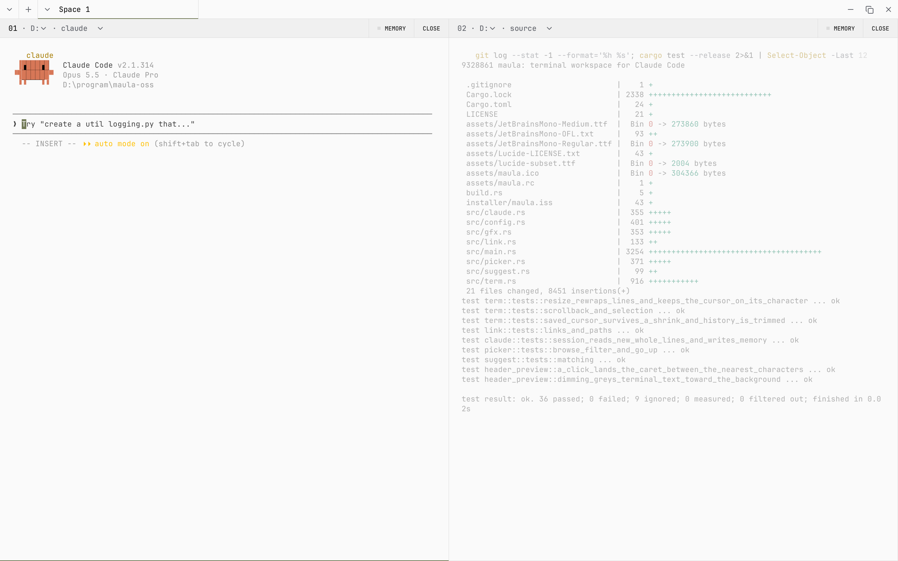
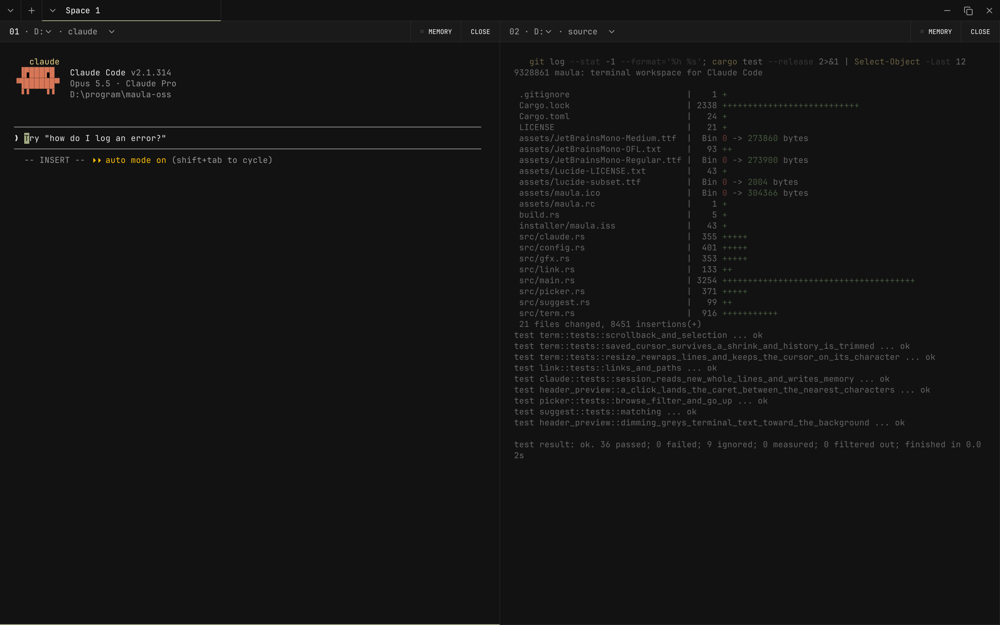
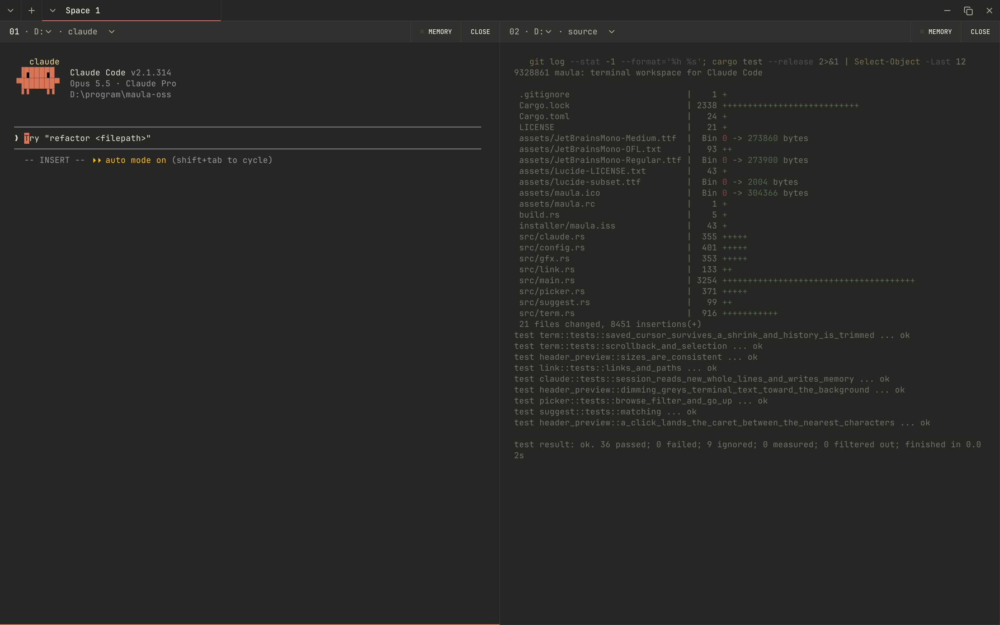
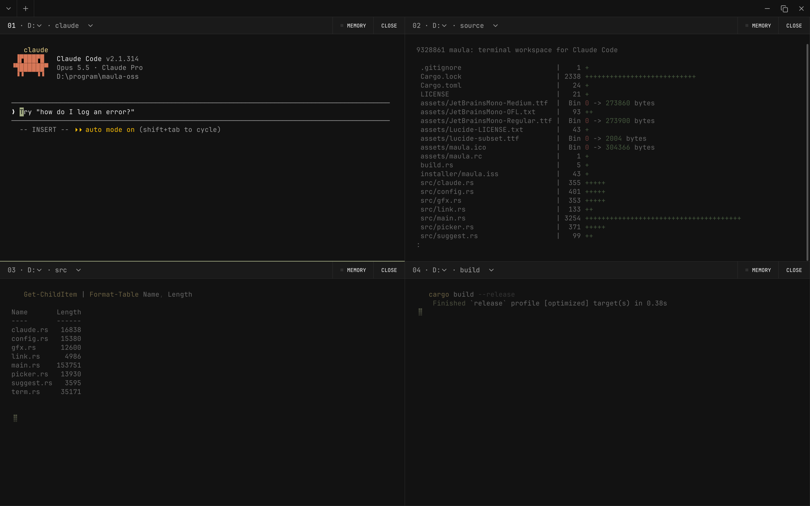
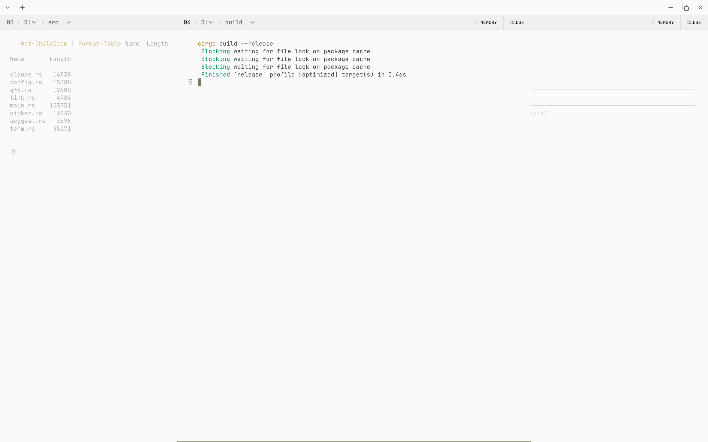
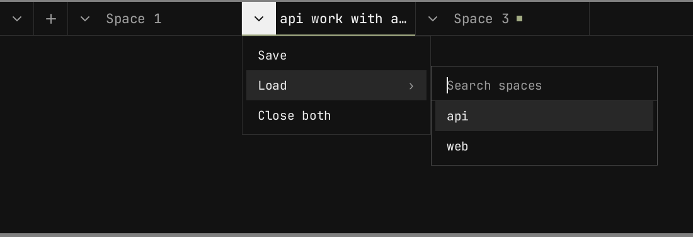
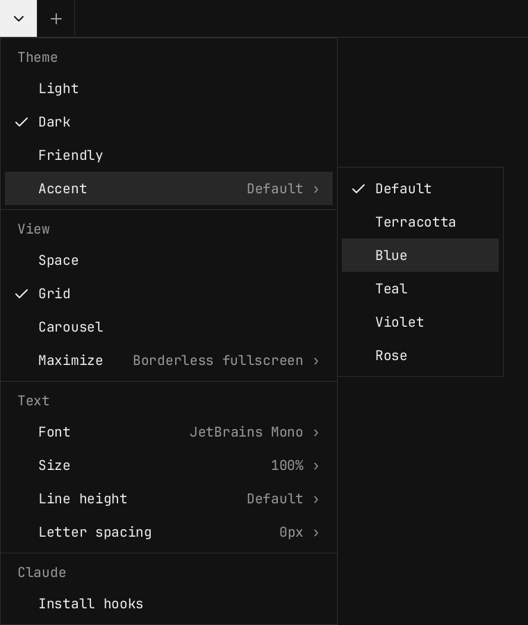

# maula

A terminal workspace for [Claude Code](https://claude.com/claude-code). It runs several terminals side by side in one native window, keeps a memory of each Claude session, and tells you which panel is waiting on you.

Written in Rust with no third-party crates: the window, the font rasterizer and the terminal are its own code on top of Win32, drawn in software, so there is no web view and no GPU requirement. It's built for Windows and runs PowerShell or Git Bash. The installer ships Microsoft's [OpenConsole](https://github.com/microsoft/terminal) (the ConPTY that Windows Terminal uses), which handles heavy output faster than the one built into Windows.



## Features

### Three themes

Light, Dark and Friendly (a soft grey between the two). Pick one from the header dropdown or in `config.toml`.

| Dark | Friendly |
|---|---|
|  |  |

Claude Code keeps its own colours by default. To have programs' exact RGB colours drawn in the nearest colour of the maula theme, set `theme_colors = true` (optional, off by default).

### Three views

- **Space**: tabs of two terminals each (the screenshots above).
- **Grid**: pages of 2×2 terminals.
- **Carousel**: a row of cards that you scroll through, with the focused one in the middle.

| Grid | Carousel |
|---|---|
|  |  |

### Spaces

Every space is a tab. You can rename it, save it, load a saved one, or close both of its terminals. A dot on a tab means a Claude session in that space is waiting for you.



### Header dropdown

The dropdown sets the theme and its accent colour, the view, what maximize does (borderless fullscreen by default, or a normal maximized window), font size, line height and letter spacing, and installs the Claude hooks. Every choice is saved to `config.toml`.



### Claude Code integration

- **Install hooks** (dropdown → Claude) adds maula's hooks to every Claude account's `settings.json`, and keeps a backup as `settings.json.maula-bak`. maula then knows which session runs in which panel and when Claude stops or asks something.
- **Render** (dropdown → Claude): *Terminal* is the character grid. *Software* draws Claude's running text in a proportional font, as a desktop app would, and keeps code, tables and diagrams on the grid. It applies to panels where the hooks report Claude running, on its classic renderer.
- **Panel note from Claude**: with the hooks installed, a Claude session started in a panel is told (via the SessionStart hook) that it can run `maula note read`, `maula note write "text"` (or `-` for stdin), `maula note append "text"` and `maula note clear` to read and edit that panel's note. It talks to the window over loopback only, using the pane's `MAULA_PANE`, `MAULA_NOTE_PORT` and `MAULA_TOKEN` variables; text is plain UTF-8, up to 8 MB. Without the hooks, tell Claude the commands yourself.
- **MEMORY** (panel header): while it's on, a summary of the session (what you needed, the decisions made, open items) is saved to `.maula/memory` in the project, so a later session or another account can pick it up.

### Terminal niceties

- The panel header shows the drive and folder, each with a picker to jump elsewhere.
- Typing `cd` plus three or more characters suggests matching sub-folders.
- Ctrl+click opens links in the browser and `path:line:col` in your editor (`editor = "code -g"`).
- To select more than fits on screen, drag past the top or bottom of a panel, or use the wheel while dragging.
- Ctrl+C copies while text is selected; otherwise it sends ^C.
- `clear` / `cls` also clears maula's scrollback. A full-screen program's own clear (and the repaint right after a resize) leaves it alone.
- Programs that use the mouse (Claude Code's full-screen view, vim, htop) get the wheel, clicks and focus changes; hold Shift to select text or scroll maula's own scrollback instead.

### Keyboard shortcuts

| Keys | Action |
|---|---|
| Ctrl+Shift+N | New terminal |
| Ctrl+Shift+W | Close the focused terminal |
| Ctrl+Tab | Focus the next terminal (in Space view, within the space) |
| Ctrl+Shift+Tab | Switch to the next space |
| Ctrl+Shift+G | Cycle the view: Space, Grid, Carousel |
| Ctrl+Shift+F | Search the scrollback |
| Ctrl+Shift+C / Ctrl+Shift+V | Copy / paste (Ctrl+V pastes too) |

## Install

Download `maula-setup-<version>.exe` from [Releases](https://github.com/anplusdre/maula/releases) and run it. It installs per user (no admin rights) and needs Windows 10 1809 or later.

To build it yourself, with Rust 1.85+ (edition 2024):

```sh
cargo build --release
# target/release/maula.exe
```

The installer is per user and needs no admin rights. To build it, install [Inno Setup 6](https://jrsoftware.org/isinfo.php) and run:

```sh
"C:\Program Files (x86)\Inno Setup 6\ISCC.exe" installer\maula.iss
```

## Configuration

The config lives in `%APPDATA%\maula\config.toml` and is created with comments the first time maula runs. A minimal example:

```toml
theme = "dark"        # light | dark | friendly
view = "space"        # space | grid | carousel
accent = "default"    # default | terracotta | blue | teal | violet | rose
maximize = "fullscreen" # fullscreen (borderless) | window
render = "terminal"   # terminal | software (panels running Claude)
# shell = "C:/Program Files/Git/bin/bash.exe"
# editor = "code -g"
# theme_colors = true # recolour programs (Claude Code included) to the theme palette

[[panel]]
name = "api"
dir = "D:/work/api"
cmd = "claude"
```

Each theme's colours can be overridden under `[light]`, `[dark]` or `[friendly]`. Each panel can override them with its own `bg` and `accent`.

## Troubleshooting

If maula closes unexpectedly, look in `%APPDATA%\maula\crash.log`: every panic is added there with its source file and line. Include it when you report a bug.

## License

[MIT](LICENSE). Bundles JetBrains Mono ([OFL](assets/JetBrainsMono-OFL.txt)) and a subset of Lucide icons ([ISC](assets/Lucide-LICENSE.txt)).
